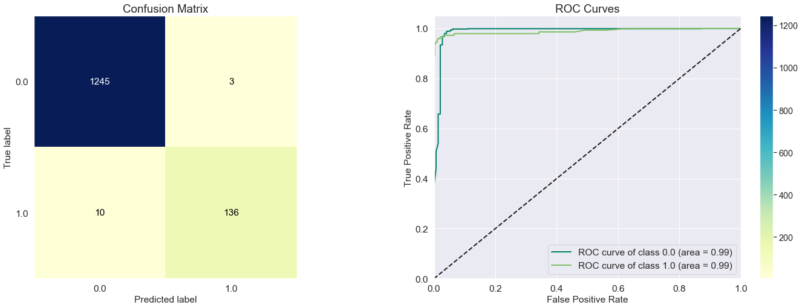
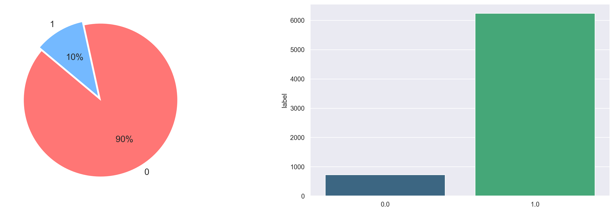

# Detecting Anxiety and Depression Signals in Short Text

A text classifier that flags short written posts showing signs of anxiety or depression. I cleaned the text, turned it into TF-IDF features and compared two models, Naive Bayes and Random Forest.

**Notebook:** [`Students Anxiety and Depression Classify Model.ipynb`](<Students Anxiety and Depression Classify Model.ipynb>)

---

## Results

Test set: 1,394 posts (20% hold-out, stratified), 146 of them labelled as showing anxiety or depression.

| Model | Accuracy | Precision | Recall | Flagged posts caught |
|---|---|---|---|---|
| Naive Bayes | 0.934 | 1.00 | 0.37 | 54 of 146 |
| **Random Forest (300 trees)** | **0.991** | **0.98** | **0.93** | **136 of 146** |

**Accuracy is the wrong number to look at here.** Only 10% of posts are positive, so a model that flags nothing still scores 90% accuracy. Naive Bayes looks good on accuracy (93%) but misses almost two-thirds of the posts that matter. Recall is the number that counts, and Random Forest is far better on it.



---

## Data

- 6,982 short English text posts, each labelled `1` (shows anxiety or depression) or `0` (does not)
- After dropping 12 rows with missing values: 6,970 posts, of which 6,240 are `0` and 730 are `1` (about 10% positive)



**Source:** [Students Anxiety and Depression Dataset](https://www.kaggle.com/datasets/sahasourav17/students-anxiety-and-depression-dataset) by Sourav Saha on Kaggle. The author allows educational use only, not commercial use. Download it as `dataset.xlsx`; the file isn't included in this repository.

---

## Method

1. **Explore:** class balance, post length in words and characters by label, word clouds and the 25 most common words for each class
2. **Clean the text:** lowercase, remove URLs and punctuation, remove English stop words (NLTK), Porter stemming
3. **Features:** TF-IDF, top 2,500 terms, ignoring terms that appear in fewer than 2 posts. The vectoriser is fitted on the training set only.
4. **Split:** 80/20 train/test, stratified so both sets keep the 10% positive rate
5. **Models:** Multinomial Naive Bayes and Random Forest (300 trees), each scored on accuracy, precision, recall, a confusion matrix and an ROC curve

---

## Limitations

- **The results are almost too good.** 99% accuracy on short text is unusual. Before trusting it I'd check for duplicate or near-duplicate posts shared across the train and test sets, and test on posts from a different source.
- **One train/test split.** Cross-validation would show how stable the scores are.
- **No threshold tuning.** Both models use the default 0.5 cut-off. For screening, a lower threshold that catches more true cases is usually worth some extra false alarms.
- **This is not a diagnostic tool.** It finds language patterns linked to the labels. It can't tell whether a person is actually unwell.

---

## Run it

```bash
pip install pandas numpy scikit-learn nltk wordcloud seaborn matplotlib scikit-plot openpyxl
python -c "import nltk; nltk.download('punkt'); nltk.download('stopwords')"
```

Download the [dataset from Kaggle](https://www.kaggle.com/datasets/sahasourav17/students-anxiety-and-depression-dataset), save it as `dataset.xlsx` next to the notebook, change the `path` variable in the third cell to `''`, then run all cells.

---

**Tools:** Python, pandas, NLTK, scikit-learn, seaborn, matplotlib

Built in March 2023 during my BTech in Computer Science (AI & ML) at SRM Institute of Science and Technology.
